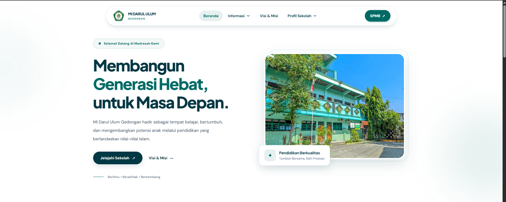

# Website MI Darul Ulum Gedongan

Website profil dan informasi **MI Darul Ulum Gedongan** yang dikembangkan dengan tampilan modern, bersih, interaktif, dan responsif. Website ini dirancang untuk membantu siswa, orang tua, dan masyarakat mengenal madrasah serta mengakses informasi kegiatan sekolah.

## Preview Beranda



*Tampilan Hero Section: perkenalan madrasah, foto gedung sekolah, navigasi floating, serta tombol untuk menjelajahi informasi sekolah.*

## Tentang Website

Website MI Darul Ulum Gedongan menampilkan profil madrasah dengan warna utama **hijau tua (`#003844`)**, **teal (`#006B66`)**, dan **putih (`#FFFFFF`)**. Antarmuka dirancang agar tetap mudah digunakan pada laptop, tablet, maupun ponsel.

## Fitur Website

- **Beranda:** Hero Section dengan foto gedung sekolah dan pengantar madrasah.
- **Navigasi:** Floating navbar dengan menu dan dropdown responsif.
- **Visi & Misi:** Informasi arah dan tujuan pendidikan madrasah.
- **Sambutan Kepala Madrasah:** Foto dan sambutan pimpinan madrasah.
- **Berita & Prestasi:** Ringkasan berita dengan carousel, serta halaman galeri berita.
- **Struktur Organisasi:** Halaman informasi guru dan pengelola madrasah.
- **Ajakan Bergabung:** Bagian khusus yang mengarahkan pengunjung ke informasi SPMB.
- **Footer:** Navigasi tambahan dan informasi kontak sekolah.
- **Animasi & Responsivitas:** Efek masuk saat halaman dibuka atau di-scroll, serta tata letak yang menyesuaikan perangkat.

> **Status proyek:** dalam pengembangan. Sebagian konten masih berupa contoh/placeholder. Integrasi pengelolaan berita menggunakan database MySQL dan dashboard admin masih direncanakan.

## Teknologi yang Digunakan

| Teknologi | Kegunaan |
| --- | --- |
| Laravel | Framework aplikasi web |
| Blade | Template halaman |
| Tailwind CSS | Styling dan desain responsif |
| Alpine.js | Interaksi antarmuka |
| JavaScript | Animasi dan efek scroll |
| MySQL | Database untuk fitur backend yang sedang dikembangkan |
| Vite | Pengembangan dan build aset frontend |

## Menjalankan Proyek di Lokal

Pastikan **PHP, Composer, Node.js/npm**, dan lingkungan Laravel sudah tersedia. Untuk fitur database, siapkan MySQL melalui Laragon atau layanan MySQL lain.

```bash
composer install
npm install
```

Salin `.env.example` menjadi `.env`, sesuaikan konfigurasi lokal jika diperlukan, kemudian jalankan:

```bash
php artisan key:generate
```

Jalankan dua terminal terpisah:

**Terminal 1 — Laravel**

```bash
php artisan serve
```

**Terminal 2 — Vite**

```bash
npm run dev
```

Buka **http://127.0.0.1:8000** di browser.

## Rencana Pengembangan

- Menghubungkan berita dan prestasi dengan MySQL.
- Membuat autentikasi dan dashboard admin.
- Menambahkan pengelolaan konten serta unggah foto.
- Menyempurnakan informasi dan alur pendaftaran SPMB.
- Melakukan pengujian responsif, aksesibilitas, dan performa.

---

**MI Darul Ulum Gedongan** — *Berilmu • Berakhlak • Berkembang*
